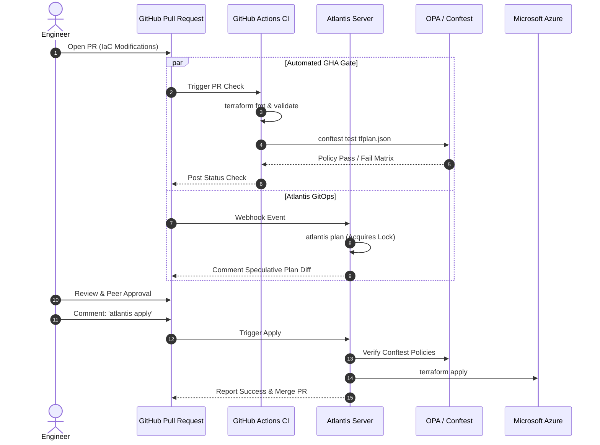

# Terraform-Based Azure Infrastructure Automation & Governance

[](https://www.terraform.io/)
[](https://github.com/features/actions)
[](https://www.runatlantis.io/)
[](https://www.openpolicyagent.org/)

An enterprise GitOps and Policy-as-Code governance platform for Microsoft Azure. Automates Terraform pull-request planning, state locks, and reviews via Atlantis, while enforcing strict compliance and security guardrails using Open Policy Agent (OPA / Rego) and GitHub Actions.

---

## 1. GitOps & Policy Enforcement Workflow



---

## 2. Policy-as-Code Guardrail Matrix (Rego)

| Guardrail Policy | Target Resource | Enforcement Rule | Business Impact |
| :--- | :--- | :--- | :--- |
| **`tags.rego`** | All Azure Resources | Must include `Environment`, `Owner`, `Project`, `CostCenter`, `ManagedBy` | FinOps accountability & automated chargeback |
| **`regions.rego`** | All Resource Groups | Prohibits provisioning outside `eastus`, `eastus2`, `centralus`, `westeurope` | Data residency compliance & regulatory adherence |
| **`network_rules.rego`** | `azurerm_network_security_rule` | Strictly blocks inbound `0.0.0.0/0` on port `22` (SSH) and `3389` (RDP) | Eliminates brute-force exposure |
| **`storage_encryption.rego`** | `azurerm_storage_account` | Requires `enable_https_traffic_only = true` and `min_tls_version = "TLS1_2"` | Zero-trust encryption in transit |

---

## 3. Directory Layout

```
.
├── atlantis.yaml                   # Atlantis server-side GitOps configuration
├── .github/
│   └── workflows/
│       └── terraform-governance.yml # GitHub Actions PR governance workflow
├── policy/                         # Open Policy Agent (OPA) Rego definitions
│   ├── tags.rego                   # Tag taxonomy enforcement
│   ├── regions.rego                # Permitted Azure regional boundaries
│   ├── network_rules.rego          # Ingress NSG perimeter controls
│   ├── storage_encryption.rego     # In-transit TLS and HTTPS requirements
│   └── tests/
│       └── governance_test.rego    # Automated test cases validating Rego policies
├── infrastructure/
│   ├── main.tf                     # Compliant cloud resource declarations
│   ├── variables.tf                # Parameter declarations with validation
│   ├── outputs.tf                  # Exported state outputs
│   └── versions.tf                 # Provider constraints and backend state
└── examples/
    └── terraform.tfvars.example    # Compliant sample variables
```

---

## 4. Atlantis Configuration (`atlantis.yaml`)

Atlantis runs pull request planning and execution through server-side webhooks:

- **Autoplan:** Automatically triggers `atlantis plan` when `.tf` files or `.rego` policies are modified.
- **Pre-Apply Policy Check:** Executes `conftest test` against the generated `tfplan.json` prior to permitting `atlantis apply`.
- **Apply Requirements:** Mandates that PRs must be approved and mergeable before state changes can be applied to production.

---

## 5. Local Policy Verification

Engineers can validate their Terraform plan against OPA policies locally before raising pull requests:

```bash
# 1. Initialize and generate plan JSON
cd infrastructure
terraform init -backend=false
terraform plan -var-file="../examples/terraform.tfvars.example" -out=tfplan.bin
terraform show -json tfplan.bin > tfplan.json

# 2. Test against OPA Rego policies with Conftest
conftest test tfplan.json --policy ../policy/

# 3. Execute Rego unit tests
conftest verify --policy ../policy/
```
